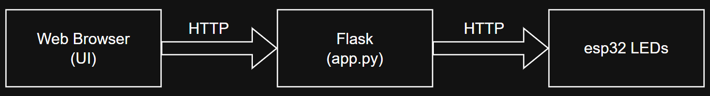

# Light-App (WIP)

This is an app I made for fun because i needed some LED lights for my DnD sessions.

It's basically a small web-based lighting controller. It lets you control multiple "LED stations", controlled by esp32s, from a single web interface, making it possible to create atmospheric lighting effects for different scenes, locations, and encounters.



To track what stations I have an where they are I'm using a dictionary that i change before launching the server (this can and will be updated in the future)
git

## Native Ambilight Engine (Windows)

The screen-color service source now builds to a native C++ executable using DirectX Desktop Duplication. It publishes the existing `ambient_colors` WebSocket message on `ws://127.0.0.1:8765`; `app.py` remains unchanged and continues to update its preview API. The executable is not checked into the repository and must be built with the steps below.

### Build

Install Visual Studio 2022 with the **Desktop development with C++** workload and CMake 3.24 or newer. CMake downloads the single-header JSON dependency on the first configure, so that step needs internet access.

From the project directory, run:

```powershell
cmake -S . -B build/ambient -A x64
cmake --build build/ambient --config Release
```

With the Visual Studio generator, the executable is `build/ambient/Release/ambient.exe`. CMake copies `ambient_config.json` beside it after building.

### Run

Start `ambient.exe` and `python app.py` in separate terminals. The Flask updater reconnects to the WebSocket server if the engine starts later. Desktop Duplication requires an interactive Windows desktop session.

`ambient_config.json` controls the target frame rate, edge sample band/inset, smoothing (`smoothing_alpha` from 0 to 1), RGB gains, WebSocket bind address/port, and optional UDP destination. Each screen edge is split into 30 averaged RGB regions, for 120 samples total. WebSocket color arrays retain the existing `{r, g, b}` object format and contain 30 entries per edge.

The current Flask preview intentionally remains unchanged: `app.py` keeps only the first three samples from `left` and `right`, and does not expose the full 120-color array through `/api/ambient-colors`.

UDP streaming is disabled by default. When enabled, the engine sends one raw 360-byte RGB datagram per captured frame, in clockwise perimeter order: top left-to-right, right top-to-bottom, bottom right-to-left, then left bottom-to-top. The current `esp32_main.ino` does not listen for these datagrams; direct LED output requires matching UDP receive logic and a compatible packet/LED layout in the ESP32 firmware.